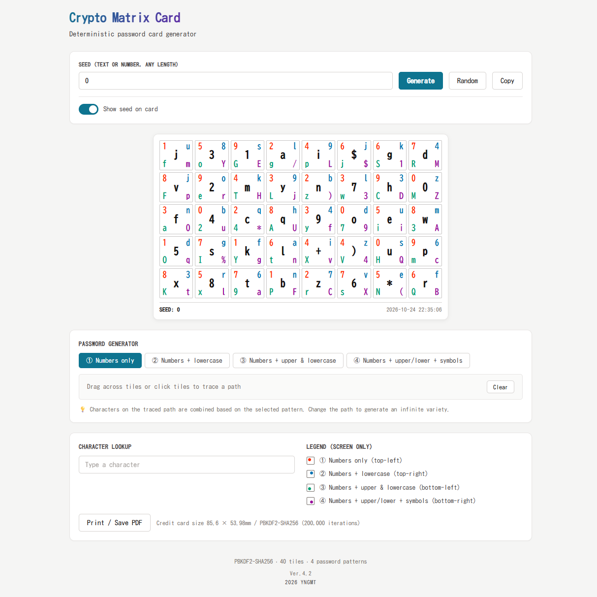

# Crypto Matrix Card

A deterministic password card generator that runs entirely in the browser — no build step, no dependencies, no server.


**Live demo:** https://jpeqtx.github.io/crypto-matrix-card/

---

## Overview

Crypto Matrix Card is a single-file web app that generates a **credit-card-sized character matrix** (85.6 × 53.98 mm, ISO/IEC 7810 ID-1) from any seed string. By tracing a path across the tiles — with a drag or a series of clicks — you derive passwords on demand, inspired by the concept of physical password cards.

The matrix is derived using **PBKDF2-SHA256 (200,000 iterations)** followed by SHA-256 counter-mode expansion. The same seed always produces the same card, and brute-forcing the seed is computationally expensive.



---

## Features

### Generation & Cryptography
- **Deterministic generation** — same seed → same card, every time
- **Strong key derivation** — PBKDF2-SHA256, 200,000 iterations, fixed salt
- **Stream expansion** — SHA-256 counter mode produces 2 KB of deterministic randomness
- **Base62 seed generator** — 16-character `0-9a-zA-Z` seed with rejection sampling (no modulo bias)

### Four password patterns
Aligned with common site requirements:

| Pattern | Corner | Character set |
|---|---|---|
| ① | Top-left (red) | Digits only `0-9` |
| ② | Top-right (blue) | Digits + lowercase `0-9a-z` |
| ③ | Bottom-left (green) | Digits + upper & lowercase `0-9a-zA-Z` |
| ④ | Bottom-right (purple) | Digits + upper/lower + 13 symbols |

### Interaction
- **Drag to trace** — click and drag across tiles to build a path
- **Click to toggle** — click a tile to add/remove it from the current path (6 px drag threshold prevents accidental resets)
- **Live character counter** — shows the length of the generated password
- **Pattern switch** — re-read the same path with a different pattern instantly
- **Character lookup** — find all tiles containing a given character

### Design & Accessibility
- **CUD-recommended palette** — colors from the Color Universal Design guidebook (2018), including a purple replacement for yellow (yellow fails contrast on white)
- **Position-based legend** — pattern identity is conveyed by icon position, not color alone
- **Light theme** — optimized for white cardstock and laser marking
- **Print-ready layout** — outputs exactly 85.6 × 53.98 mm with a quick reference sheet on the same A4 page

### Privacy
- **Seed visibility toggle** — show or mask the seed on the printed card
- **Zero dependencies** — no jQuery, no framework, no tracking
- **Offline capable** — works from `file://` in most browsers (secure context required for `crypto.subtle`)

---

## Usage

### 1. Generate a card
1. Open `index.html` (or the GitHub Pages URL).
2. Enter a **seed** — any text, number, or phrase (e.g. `my-secret-2026`). Longer is better.
3. Click **Generate**. Or click **Random** for a fresh 16-character Base62 seed.

### 2. Derive a password
1. Select a pattern (① to ④) under **Password Generator**.
2. **Drag** across the tiles — or **click** individual tiles — to build a path you can remember (initials, a heart, an L, etc.).
3. The characters along your path are concatenated and shown below, with a live character count.
4. Change the path to generate a different password. Switch patterns to reuse the same path with different character sets.

### 3. Print or engrave
1. Click **Print / Save PDF**.
2. In the browser dialog:
   - Margins: **Default / 5 mm**
   - Scale: **100% / None**
   - Paper: **A4**
3. The first element is the card (actual credit-card size), followed by the quick reference sheet.

> ⚠️ **Security note**
> The card itself is not secret. The *path you trace* and the *seed* are.
> - If you print the seed on the card and share the card, anyone can regenerate the matrix.
> - Keep the seed private, or disable **Show seed on card**.
> - The printed card is a **password generator**, not a password store.

---

## How it works

```
seed (any string)
   │
   ├─ PBKDF2-SHA256
   │     salt       = "crypto-matrix-card-v4"
   │     iterations = 200,000
   │     → 256-bit key
   │
   ├─ SHA-256 counter mode:  H(key ‖ i) for i = 0, 1, 2, …
   │     → 2,048-byte deterministic stream
   │
   └─ BytePRNG (synchronous)
           ├─ Fisher-Yates shuffle per character column
           └─ 40 tiles × { center, top-left, top-right, bottom-left, bottom-right }
```

### Tile contents

| Position | Character pool | Length |
|---|---|---|
| center | `0-9` + `a-z` + 4 random symbols | 40 unique |
| top-left (①) | `0-9` (repeated) | 40 |
| top-right (②) | `0-9a-z` (repeated) | 40 |
| bottom-left (③) | `0-9a-zA-Z` (repeated) | 40 |
| bottom-right (④) | `0-9a-zA-Z` + 13 symbols (repeated) | 40 |

All columns are independently shuffled from the same derived stream, so the matrix is fully reproducible from the seed.

### Why PBKDF2?

LCGs and raw `Math.random()` fail under adversarial inspection. PBKDF2 at 200,000 iterations makes single-guess attempts expensive and eliminates the risk of correlated outputs across browsers. The SHA-256 counter mode expands the derived key into an arbitrarily long deterministic stream while remaining independent of any platform-specific PRNG.

---

## Accessibility

The color palette follows the **CUD (Color Universal Design)** recommendations from the University of Cologne's 2018 guidebook:

| Position | Color | Contrast on white |
|---|---|---|
| ① | `#ff2800` (CUD red) | 3.9 : 1 |
| ② | `#0072b2` (CUD blue) | 5.2 : 1 |
| ③ | `#009e73` (CUD green) | 3.4 : 1 |
| ④ | `#9a0e9b` (CUD purple) | 6.6 : 1 |

**Why purple instead of yellow:** the CUD yellow (`#faf500`) has a contrast ratio of about 1.07:1 on white — effectively invisible for most users. Purple maintains the CUD framework while satisfying WCAG AA for large text (≥ 3:1).

In addition, the on-screen legend identifies patterns **by position**, not by color swatch, so the UI remains usable even if the user cannot distinguish colors at all.

On print, all four corners are rendered in **pure black**, with position as the only distinguishing feature.

---

## Printing / Laser engraving

The `@media print` stylesheet produces:

| Element | Size |
|---|---|
| Card | 85.6 × 53.98 mm (ISO/IEC 7810 ID-1) |
| Outer border | 0.25 mm |
| Tile border | 0.2 mm |
| Center glyph | 4.2 mm, bold |
| Corner glyph | 2.4 mm |
| Quick reference | 180 mm wide, below the card, on the same A4 page |

Notes for engraving:
- All corner glyphs print in **black** (monochrome-friendly).
- `print-color-adjust: exact` is set to prevent browsers from altering backgrounds.
- Verify the card dimensions after PDF export; use 100% scale with no "shrink to fit".

---

## Browser support

| Browser | Status |
|---|---|
| Chrome / Edge 90+ | ✅ |
| Firefox 90+ | ✅ |
| Safari 15+ | ✅ |
| Mobile Chrome / Safari | ✅ (pointer events) |

Requires `crypto.subtle` (available only in secure contexts — `https://` or `localhost`). Opening the file via `file://` may work in some browsers but is not guaranteed.

---

## Project structure

```
crypto-matrix-card/
├── index.html          # single-file app (HTML + CSS + JS)
├── docs/
│   └── screenshot.png  # README screenshot
├── LICENSE             # Unlicense
└── README.md
```

No build step. No npm. No bundler.

---

## Changelog

| Version | Summary |
|---|---|
| **4.2** | Base62 seed generator, click-to-toggle path, CUD palette, position-based legend, drag threshold |
| 4.1 | Bold center glyph, A4 print with quick reference, four-column pattern layout |
| 4.0 | PassCard-style 4 patterns, PBKDF2-SHA256, credit-card size |
| 3.0 | PBKDF2 migration, seed toggle, print layout |
| 2.0 | Dark theme redesign, vanilla JS rewrite |
| 1.0 | Initial prototype (jQuery + LCG) |

---

## License

This is free and unencumbered software released into the public domain under the [Unlicense](LICENSE).

Anyone is free to copy, modify, publish, use, compile, sell, or distribute this software, either in source code form or as a compiled binary, for any purpose, commercial or non-commercial, and by any means.
